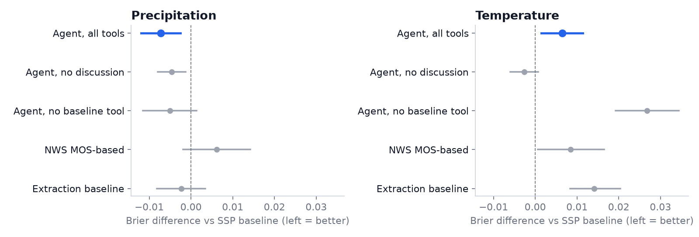
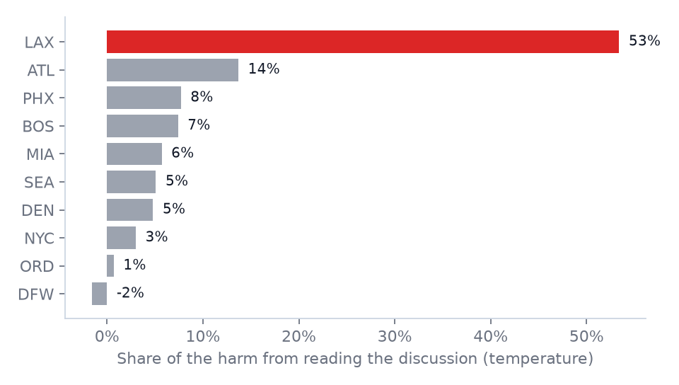
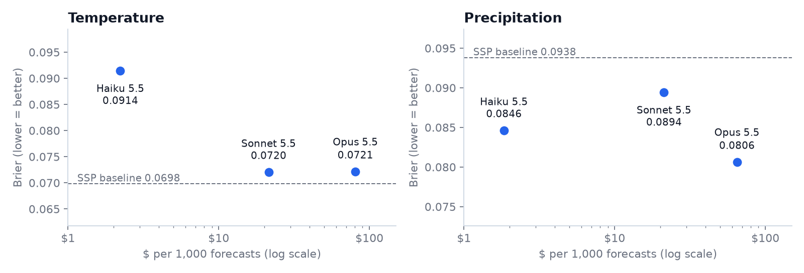

# forecast-agent-bench

**Can an LLM agent that reads forecasters' written reasoning beat classical statistical forecasting?**

A pre-registered benchmark that pits a Claude agent with point-in-time tools against a strong statistical baseline,
plus a domain-agnostic core for running the same kind of test in other domains. The first domain is weather: at
6 AM local time, will today's high reach its 1991-2020 normal, and will at least 0.01 in of rain fall, at 10 US
airports.

## Result

Scored once, on a holdout that starts after the model's training cutoff (Jul 1 to Nov 15, 2026). Brier score: lower is
better. Date-block bootstrap, Holm correction across the two pre-registered tests.

| Pre-registered test | Agent | Baseline | Agent minus baseline (95% CI) | p | Verdict |
| --- | --- | --- | --- | --- | --- |
| **Precipitation** (n = 1,271) | 0.0748 | 0.0821 | **-0.0072** (-0.0120 to -0.0025) | 0.002 | Agent better |
| **Temperature** (n = 1,321) | 0.0796 | 0.0731 | **+0.0065** (+0.0014 to +0.0114) | 0.011 | Agent worse |

The agent (Claude Haiku 5.5) beat the baseline, and official NWS MOS guidance, at predicting rain. It was worse at
temperature. The ablations explain why, and it isn't the reason expected:

- **Rain:** removing the forecast discussions left most of the gain. The win comes from how the agent weighs three
  weather models, MOS and recent errors, not from reading.
- **Temperature:** the discussions **hurt**. Without them the agent ties the baseline (0.0706 vs 0.0731, CI includes 0).



Only "Agent, all tools" was pre-registered as primary; the other rows are exploratory comparisons on the same
questions. Full tables: [domains/weather/RESULTS.md](domains/weather/RESULTS.md).

### Why the discussions hurt temperature

An exploratory error analysis after scoring ([ERROR_ANALYSIS.md](domains/weather/ERROR_ANALYSIS.md)):

- **Area-wide statements applied to one airport.** Forecast discussions describe a whole region ("highs 5-10 degrees
  below normal"). Answers citing such a statement are 11% of questions and 42% of the harm.
- **Routine weather read as news.** Los Angeles alone is 53% of the harm: the agent kept reading the usual summer
  marine layer as a reason to cool the forecast, yet LAX reached its normal on 84% of its July-November days.
- **Double counting.** Forecasters write from the same models the baseline already uses. In 45% of the most-harmed
  answers the agent says it trusts the text over the models (22% of the most-helped).
- When the discussion pushed a temperature forecast **down**, it was wrong 76% of the time.



### Cost versus quality

Same 100 primary questions per question type, exploratory:



On temperature, Sonnet 5.5 and Opus 5.5 fix Haiku's problem and match the baseline, at 10x and 36x the cost. On
rain, no model is distinguishable from Haiku, which costs about $2 per 1,000 forecasts.

### Did the model just remember the weather?

No. With no tools and no data, it scores about as well as climatology both before and after its training cutoff
(temperature: 0.2321 vs 0.2321 after the cutoff).

## How it was run

- **Pre-registered.** [SPEC.md](domains/weather/SPEC.md) was frozen before any data was downloaded. Every later
  amendment is in its dated change log, including what had been seen at the time. Code, prompts and tools were
  frozen at tag `holdout-freeze` before any holdout question was run; the holdout was scored once (tag
  `holdout-scored`) and the scorer refuses a second run.
- **Point in time by construction.** Every row of data carries the time it became knowable. Tools and baselines only
  get a snapshot as of each question's 6 AM decision time, so later data is unreachable, and every tool call is
  audit-logged with a leak tripwire.
- **A leak check that failed first.** Matching archived forecasts to exact model runs flagged about 2% of values on the
  first try. The diagnosis (repeated values, interpolated ECMWF hours) led to using ECMWF temperatures only at their
  3-hourly times; the corrected check passes for all six model and variable pairs. Both results are kept.
- **Stronger baselines than a strawman.** The statistical baseline (SSP) ties official NWS MOS guidance; an
  extraction baseline tests whether the agent merely copies numbers stated in the discussion; the training cutoff,
  ablations and a recall probe were added after an independent design review, before any agent ran.
- **Paired statistics.** All comparisons are on the same questions, with a date-block bootstrap (questions on one date
  share weather). The minimum detectable effects were recorded before the holdout ran.
- **Budget and failures.** A file-locked spend ledger enforced a hard cap from the API's own token counts ($41.99 spent
  in total). A failed question gets the baseline's probability and is still scored (1 failure in 10,000+ answers).

## Architecture

```mermaid<br/>flowchart LR<br/>  subgraph domain["domains/weather (plug-in)"]<br/>    D["Downloaders\nNOAA ACIS, Open-Meteo, IEM"] --> S["Point-in-time sources\nrow.available_at"]<br/>    Q["Frozen question sets\nfingerprinted"]<br/>    B["Baselines\nclimatology, vote, SSP, MOS, extraction"]<br/>  end<br/>  subgraph core["core (domain-agnostic)"]<br/>    P["Snapshot + ToolBox\naudit log, MCP server"] --> A["Agent runner\nLangGraph + Claude"]<br/>    A --> C["Budget + scoring\nbootstrap, Holm, lock"]<br/>  end<br/>  S --> P<br/>  S --> B<br/>  Q --> A<br/>  B --> C<br/>```

- `core/pit.py`: `Source`, `Snapshot` and `ToolBox`; tools can also be served over MCP with only a question id exposed.
- `core/agent.py`: LangGraph research-then-forecast loop on the Claude API, structured output, tool cap, spend ledger.
- `core/scoring.py`: Brier, log loss, paired and block bootstrap, Holm, Brier skill.
- `domains/weather/`: downloaders, benchmark builder, point-in-time sources, the agent's tools, baselines, scorer,
  leak check, error analysis.
- 30 tests (`pytest`).

## Limitations

- One horizon (6 AM same day) and one threshold per question type; earlier horizons may favor the text more.
- Ten stations; Los Angeles dominates the temperature result.
- The main runs use one model (Haiku 5.5); the larger models ran on 100 questions per type only.
- The error analysis, ablations and model comparison are exploratory; fixes it suggests need a new forward test on
  days after Nov 15, 2026, since this holdout is spent.
- The leak check verifies a weekly sample of days at five stations, not every value.

## Reproduce

```bash
python -m venv .venv && .venv/bin/pip install -r requirements.txt
echo "ANTHROPIC_API_KEY=..." > .env && chmod 600 .env      # never committed
python -m domains.weather.download                         # throttled, cached downloads
python -m domains.weather.build_benchmark                  # question sets + fingerprints
python -m domains.weather.checks leak                      # point-in-time check against exact model runs
python -m domains.weather.baselines                        # climatology, vote, SSP, MOS
python -m domains.weather.run_agent --track temp --system A1 --period dev --n 200 --label dev
python -m domains.weather.score                            # dev scores (the holdout is scored once)
pytest -q
```

Raw data and caches stay in the git-ignored `data/` and `.cache/` folders.

## Data sources and attribution

Weather forecast data by [Open-Meteo.com](https://open-meteo.com/), licensed under
[CC BY 4.0](https://creativecommons.org/licenses/by/4.0/). Changes: hourly 2 m temperature and precipitation from
archived runs were converted to US units and aggregated per question; no other modification. This service is based on
data and products of the European Centre for Medium-Range Weather Forecasts (ECMWF). Source: www.ecmwf.int. This ECMWF
data is published under a Creative Commons Attribution 4.0 International (CC BY 4.0). ICON forecast data: Source:
Deutscher Wetterdienst (DWD), CC BY 4.0. GFS forecast data: NOAA/NCEP (public domain). Observed temperatures,
precipitation and 1991-2020 normals: NOAA NCEI, retrieved via the Applied Climate Information System (ACIS), NOAA
Regional Climate Centers. NWS Area Forecast Discussions, hourly observations and GFS MOS guidance retrieved from the
[Iowa Environmental Mesonet](https://mesonet.agron.iastate.edu/), Iowa State University.

This project is not affiliated with or endorsed by NOAA/NWS, ECMWF, DWD, Open-Meteo, the Regional Climate Centers,
Iowa State University, or Anthropic. Not an official forecast; do not use for safety, operational or betting
decisions.

## License

Code: [MIT](LICENSE). Data and data-derived files are not covered by the MIT license; see [NOTICE](NOTICE).
